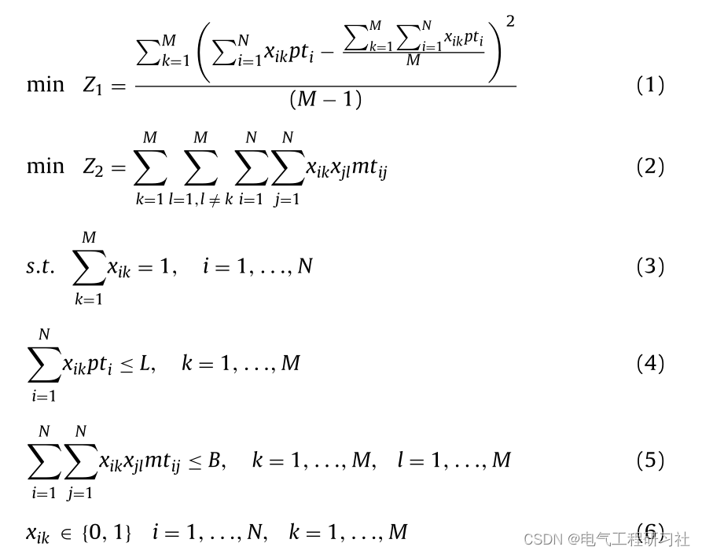
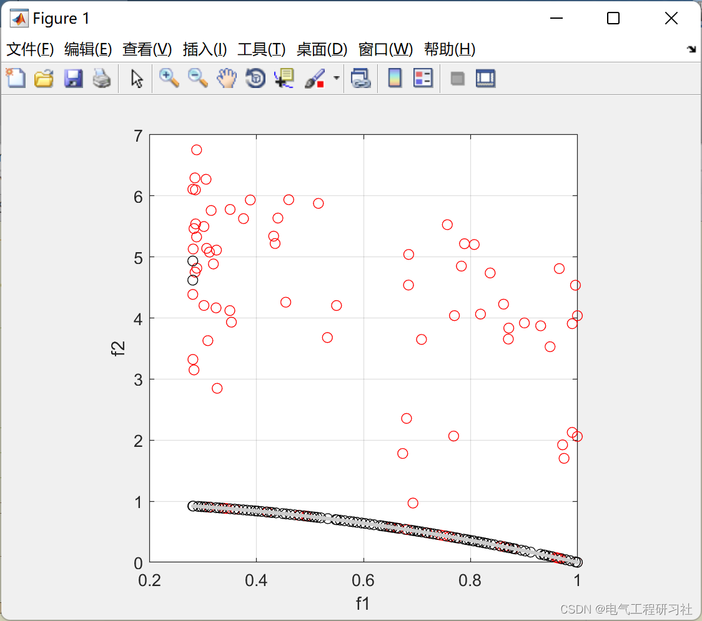
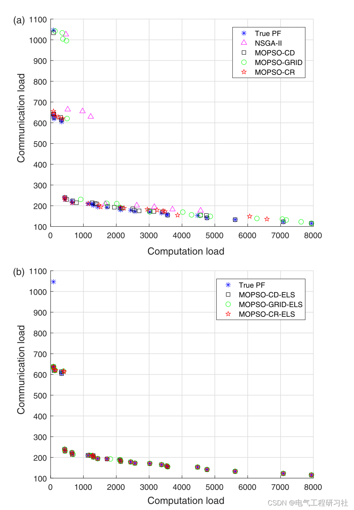
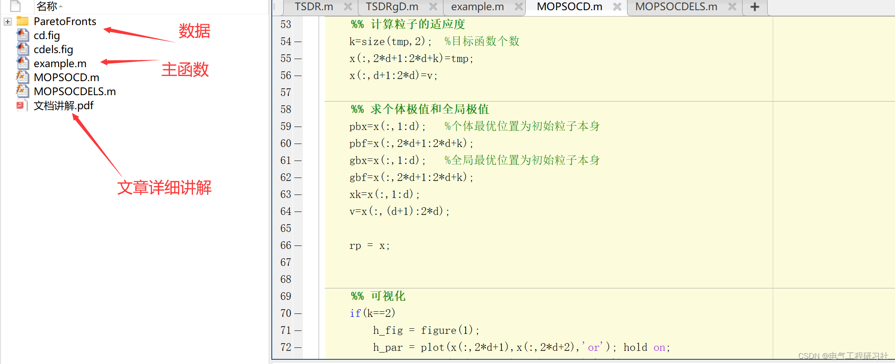

# Distributed Simulation System Dual-Objective Load Balancing Model Based on Multi-Objective Genetic Algorithm (NSGA-II) and Multi-Objective Particle Swarm Optimization (MOPSO) [Matlab Code]

🎉🎉 Welcome to your arrival 🎉🎉
📚📚📚📋Column Directory: The Beauty of Power Systems and Algorithms👨‍💻👨‍💻👨‍💻

​​​​​​​​​​​​​​​​​​​​​​​​​​​​​​​​​​​​​​​​​​​​​​​​​​​​​​​​​​​​​​​​​​​​​​​​​​​​​​​​​​​​​​​​​​​​​​​​​​​​​​​​​​​​​​​​​​​​​​​​​​​​​​​​​​​​​​​​​​​​​​​​​​​​​​​​It is recommended that readers browse the catalog in order, to avoid being suddenly plunged into a dark labyrinth without knowing how to return. It may not reveal all the answers to you, but it can certainly raise a multitude of doubts within your mind, which might lead to a different landscape of sunsets with colorful hues. If it brings you a heavy rain in the spiritual world, then take this opportunity to wash away the dust from the "truth" that was previously stored there. Perhaps, after the rain subsides and clouds clear up, the sky and earth will become even more clear...🔎🔎🔎
📋📋📋This article is organized as follows: ⛳️⛳️⛳️Table of Contents: 1. Overview 2. Mathematical Model 3. Multi-objective Genetic Algorithm and Multi-Objective Particle Swarm Optimization 4. Running Results 5. MATLAB Code + Data + Documentation Explanation 6. Final Thoughts
Distributed systems are advantageous for their high utilization, scalability, and parallelism, allowing them to run in parallel to handle computationally intensive problems. However, several challenges arise from the distributed structure, such as communication issues between nodes and mapping and allocation of system resources and computing nodes.
Higher-Level Architecture (HLA) is widely used in distributed simulation development. Although HLA supports large-scale distributed simulations, the load balancing mechanism during simulation processes has not been standardized. When the simulation system operates under non-optimal allocation conditions, a load imbalance issue may occur due to insufficient computational capacity.
The results of load balancing manifest in two aspects: firstly, it effectively shortens the average response time of tasks, i.e., trying to minimize the simulation process's running time to ensure stable and smooth operation; secondly, it maximizes the utilization of the entire system's simulation resources, reducing unnecessary resource waste.
High-Level Architecture (HLA) is a software architecture specification for distributed simulation systems, which does not involve load balancing. Therefore, in the simulation process of HLA, it is impossible to resolve issues caused by long simulation times and uneven distribution of simulation tasks, such as distortion. This paper will study component-level simulation systems and solve the problem of load imbalance. The goal is to find a set of Pareto optimal solutions to minimize the imbalance between computational loads and total communication loads with load constraints in the model. To address this issue, a new integer programming model is proposed. A non-dominated sorting genetic algorithm with elitism (NSGA-II) and multi-objective particle swarm optimization algorithm (MOPSO) are used to solve this problem.The paper analyzes different global optimal selection methods (crowding distance, adaptive grid and comprehensive sorting) and perturbation methods (fast descent and elite learning strategy) for MOPSO. Since the parameters of the algorithm have a significant impact on its performance, the proposed algorithm's parameters are adjusted using the Taguchi method with new response values. Five performance indicators are used to evaluate the results of these algorithms. Based on these results, network control simulation platforms will be used to test and verify these schemes. Numerical results indicate that the proposed multi-particle swarm optimization algorithm with ELS operator outperforms other proposed algorithms in solving this problem. Additionally, the proposed strategies can address load imbalance issues in HLA-based systems.
2 Mathematical Model
This paper considers a dual-objective load balancing problem with computational and communication load constraints. As mentioned earlier, this problem is inspired by the load allocation issue in distributed simulation systems, namely HLA. In an HLA-based distributed simulation system, simulation tasks can be divided into federated member-level and component-level.

Equation (1) minimizes the variance of the computational load on simulation nodes. Equation (2) minimizes the total communication load between simulation nodes. Equation (3) specifies that each simulation task is precisely assigned to a simulation node. Equation (4) ensures the computation load constraint. Equation (5) guarantees the communication load constraint. Equation (6) represents the non-negativity and completeness of variables. For more details, refer to Section 5, which contains detailed explanations within the folder.

3 Multi-Objective Genetic Algorithm and Multi-Objective Particle Swarm Optimization see Section 5 for detailed articles explaining these methods.

4 Run Results

5 Matlab Code + Data + Documentation Explanation
This paper only showcases part of the code, with all codes available in:
function REP = MOPSOCD(params,MultiObj)\n\n    %% Parameters\n    Np      = params.Np;\n    Nr      = params.Nr;\n    maxgen  = params.maxgen;\n    W       = params.W;\n    C1      = params.C1;\n    C2      = params.C2;\n    %ngrid   = params.ngrid;\n    maxvel  = params.maxvel;\n    %u_mut   = params.u_mut;\n    fun     = MultiObj.fun;\n    nVar    = MultiObj.nVar;\n    var_min = MultiObj.var_min(:);\n    var_max = MultiObj.var_max(:);\n\n\n    \n     \n    d=nVar;   % Search space dimension (number of unknowns)\n\n    xmin=var_min;\n    xmax=var_max;\n    xrange=xmax-xmin;\n\n\n    n=Np;  % Initialize the number of individual groups\n    MaxDT=maxgen;    %Maximum number of iterations\n\n    rp=[];  %External archive, where the archive stores the non-dominating solutions saved from each generation and also represents the results of algorithmic solution.\n    rpmax=Nr;  %Archive Size\n    c1=C1;c2=C2;\n    w=W;   % Inertia weight\n    % pbx n*d   Matrix---Individual Optimal Solution\n    % gbx n*d   Matrix---Global Optimum (Each particle has its own global optimal solution)\n    % pbf n*k   Matrix - Individual Optimal Value\n    % gbf n*k   Matrix----Global Optimum Value\n\n    % Generate a random number of particles, initialize their positions and velocities.\n    %x=xmin+xrange.*rand(n,d);\n\n    x=[];\n    for i=1:n\n        x(i,:)=xmin'+xrange'.*rand(1,d);\n    end\n\n    v=zeros(n,d); \n\n    maxvel   = (var_max-var_min).*maxvel./100;\n\n    tmp = fun(x);\n    %% Calculate the fitness of particles.\n    k=size(tmp,2);  % Number of target functions\n    x(:,2*d+1:2*d+k)=tmp; \n    x(:,d+1:2*d)=v; \n    \n    %% Calculate individual and global extreme values.\n    pbx=x(:,1:d);   % The optimal individual position is the initial particle itself.\n    pbf=x(:,2*d+1:2*d+k); \n    gbx=x(:,1:d);   % The global optimal position is the initial particle itself.\n    gbf=x(:,2*d+1:2*d+k); \n    xk=x(:,1:d); \n    v=x(:,(d+1):2*d); \n\n    rp = x;\n    \n    \n    %% Visualization\n    if(k==2)\n        h_fig = figure(1);\n        h_par = plot(x(:,2*d+1),x(:,2*d+2),'or'); hold on;\n        h_rep = plot(rp(:,2*d+1),rp(:,2*d+2),'ok'); hold on;\n        try\n            set(gca,'xtick',REP.hypercube_limits(:,1)','ytick',REP.hypercube_limits(:,2)');\n            axis([min(REP.hypercube_limits(:,1)) max(REP.hypercube_limits(:,1)) ...\n                  min(REP.hypercube_limits(:,2)) max(REP.hypercube_limits(:,2))]);\n            grid on; xlabel('f1'); ylabel('f2');\n        end\n        drawnow;\n    end\n    if(k==3)\n        h_fig = figure(1);\n        h_par = plot3(POS_fit(:,1),POS_fit(:,2),POS_fit(:,3),'or'); hold on;\n        h_rep = plot3(REP.pos_fit(:,1),REP.pos_fit(:,2),REP.pos_fit(:,3),'ok'); hold on;\n        try\n                set(gca,'xtick',REP.hypercube_limits(:,1)','ytick',REP.hypercube_limits(:,2)','ztick',REP.hypercube_limits(:,3)');\n                axis([min(REP.hypercube_limits(:,1)) max(REP.hypercube_limits(:,1)) ...\n                      min(REP.hypercube_limits(:,2)) max(REP.hypercube_limits(:,2))]);\n        end\n        grid on; xlabel('f1'); ylabel('f2'); zlabel('f3');\n        drawnow;\n        axis square;\n    end\n    display(['Generation 0 - Repository size: ' num2str(size(rp,1))]);\n\n\n    % Starting the loop\n    for t=1:MaxDT \n        % Iterating according to the particle swarm formula, position and velocity update\n        gen = t;\n        for i=1:n           \n            %v(i,:)=0.3.*randn(1,d)+c1.*rand.*(pbx(i,:)-xk(i,:))+c2.*rand.*(gbx(i,:)-xk(i,:)); \n            v(i,:)=w.*v(i,:)+c1.*rand.*(pbx(i,:)-xk(i,:))+c2.*rand.*(gbx(i,:)-xk(i,:)); \n            for j=1:d \n                if v(i,j)>maxvel(j) \n                    v(i,j)=maxvel(j); \n                elseif v(i,j)<-maxvel(j) \n                    v(i,j)=-maxvel(j); \n                end \n            end \n            xk(i,:)=xk(i,:)+v(i,:); \n            for j=1:d \n                if xk(i,j)>xmax(j) \n                    xk(i,j)=xmax(j);\n                elseif xk(i,j)<xmin(j) \n                    xk(i,j)=xmin(j);\n                end \n            end \n        end \n\n\n        for i=1:n   \n            mu=0.1;             % Mutation Rate\n            pm=(1-(t-1)/(MaxDT-1))^(1/mu);\n            if rand<pm\n                xk(i,:) = Mutate(xk(i,:),pm,xmin,xmax);\n            end \n            for j=1:d \n                if xk(i,j)>xmax(j) \n                    xk(i,j)=xmax(j);\n                elseif xk(i,j)<xmin(j) \n                    xk(i,j)=xmin(j);\n                end \n            end \n        end\n        \n        \n   \n        \n        \n        x(:,1:d)=xk; \n        x(:,(d+1):2*d)=v; \n        % Calculate the fitness of particles\n        x(:,2*d+1:2*d+k)=fun(xk); \n\n        % Calculate the non-dominated solution set np (Quicksort method)\n        q=x;np=[]; \n        while isempty(q)==0 \n            xsb=q(1,:); \n            q(1,:)=[]; \n            flag=1;    % If flag == 1, then xsb is a non-dominating solution, it can be placed in the non-dominating solution set.\n            [column,row]=size(q); \n            for i=1:column \n                dom_less=0; \n                dom_equal=0; \n                dom_more=0; \n                for l=1:k \n                    if xsb(2*d+l)<q(i,2*d+l) \n                        dom_less=dom_less+1; \n                    elseif xsb(2*d+l)==q(i,2*d+l) \n                        dom_equal=dom_equal+1; \n                    else \n                        dom_more=dom_more+1; \n                    end \n                end \n\n                % If xsb dominates q(i), mark the line where q(i) is as 0 to be deleted later for marking\n                if dom_more==0&dom_equal~=k   \n                    q(i,:)=0;  \n                % If q(i) dominates xsb, then xsb is not a non-dominated solution and cannot be placed in the set of non-dominated solutions.\n                elseif dom_less==0&dom_equal~=k  \n                    flag=0;break \n                end \n            end \n            if flag==1     % If xsb is a non-dominated solution, then put it into the set np of non-dominated solutions.\n                np=[np;xsb]; \n            end \n            % Remove the lines marked as 0 in q, leaving only particles not dominated by xsb, which is a simple aspect of quick sort\n            q(~any(q,2),:)=[];  \n        end \n\n        % Update individual extreme value (if the current position dominates its individual extreme value position, then update to the current position)\n        for i=1:n \n            dom_less=0; \n            dom_equal=0; \n            dom_more=0; \n            for l=1:k \n                if x(i,2*d+l)<pbf(i,l) \n                    dom_less=dom_less+1; \n                elseif x(i,2*d+l)==pbf(i,l) \n                    dom_equal=dom_equal+1; \n                else \n                    dom_more=dom_more+1; \n                end \n            end \n            if dom_more==0&dom_equal~=k \n                pbf(i,:)=x(i,2*d+1:2*d+k); \n                pbx(i,:)=x(i,1:d); \n            end \n        end \n        % Update external set rp (insert non-dominating sets according to dominance relations into the external set)\n        [column,row]=size(rp); \n        if column==0 \n            rp=np; \n        else \n            [column2,row2]=size(np); \n            for i=1:column2 \n                flag=1;   % If flag==1, np(i,:) can be placed in an external collection.\n                [column1,row1]=size(rp); \n                for j=1:column1 \n                    dom_less=0; \n                    dom_equal=0; \n                    dom_more=0; \n                    for l=1:k \n                        if np(i,2*d+l)<rp(j,2*d+l) \n                            dom_less=dom_less+1; \n                        elseif np(i,2*d+l)==rp(j,2*d+l) \n                            dom_equal=dom_equal+1; \n                        else \n                            dom_more=dom_more+1; \n                        end \n                    end \n                % If particle np(i,:) in non-dominant set dominates particle rp(j,:) in external set,\n                % This will mark the line where rp(j,:) is as 0 to be deleted later as a marker.\n                    if dom_more==0&dom_equal~=k \n                        rp(j,:)=0;  \n                % If rp(j,:) dominates np(i,:), it means np(i,:) is dominated by rp(j,:).\n                % Therefore, np(i,:) is definitely not a non-dominated solution and cannot be included in the set of non-dominated solutions.\n                    elseif dom_less==0&dom_equal~=k  \n                        flag=0;break \n                    end \n                end \n                if flag==1     % If flag==1, then np(i,:) can be placed in an external collection.\n                                        rp=[rp;np(i,:)]; \n                end \n                rp(~any(rp,2),:)=[]; \n            end \n        end \n\n        np = rp;\n        [column,row]=size(rp); \n        for i=1:column\n            for j=i:column\n                if i~=j && sum(np(i,1:d)-np(j,1:d) == 0) == d\n                    rp(i,:)=0; \n                    break;\n                end\n            end\n        end\n        rp(~any(rp,2),:)=[]; \n        %Based on the Crowd Distance Control File Size\n        % (Calculate the crowding distance of external particles, sort them in descending order and remove the extra individuals afterward)\n        [column,row]=size(rp); \n        indexrp=[1:column]'; \n        rp=[rp indexrp];   % Indexing\n        rp(:,2*d+k+2)=zeros(column,1);   % Used to save crowded distance.\n        for i=1:k \n            rp=sortrows(rp,2*d+i);   % Sort the particles in ascending order according to the i-th target function value.\n            if column>2 \n                for j=2:column-1 \n                    rp(j,2*d+k+2)= rp(j,2*d+k+2)+(rp(j+1,2*d+i)-rp(j-1,2*d+i))/(rp(column,2*d+i)-rp(1,2*d+i)); \n                end \n            end \n            rp(1,2*d+k+2)=rp(1,2*d+k+2)+inf; \n            rp(column,2*d+k+2)=rp(column,2*d+k+2)+inf; \n        end \n        rp=sortrows(rp,-(2*d+k+2));     % External collection sorted by crowding distance in descending order\n        if column>rpmax \n            rp=rp(1:rpmax,:); \n        end \n\n        % Update global extreme values (at this point, the external set has been sorted in descending order of crowding distance, and a random selection is made from the front part of the external set)\n        for i=1:n \n        % Generate a random number, selecting from the top 10% of particles in the external set.\n            randomnumber=ceil(rand*column/10);  \n            gbx(i,:)=rp(randomnumber,1:d);     % Global optimal position\n            gbf(i,:)=rp(randomnumber,2*d+1:2*d+k); \n        end \n        rp(:,2*d+k+1:2*d+k+2)=[]; \n        \n        \n         % Plotting and verbose\n        if(k==2)\n            figure(h_fig); delete(h_par); delete(h_rep);\n            h_par = plot(x(:,2*d+1),x(:,2*d+2),'or'); hold on;\n            h_rep = plot(rp(:,2*d+1),rp(:,2*d+2),'ok'); hold on;\n            try\n                set(gca,'xtick',REP.hypercube_limits(:,1)','ytick',REP.hypercube_limits(:,2)');\n                axis([min(REP.hypercube_limits(:,1)) max(REP.hypercube_limits(:,1)) ...\n                      min(REP.hypercube_limits(:,2)) max(REP.hypercube_limits(:,2))]);\n            end\n            if(isfield(MultiObj,'truePF'))\n                try delete(h_pf); end\n                h_pf = plot(MultiObj.truePF(:,1),MultiObj.truePF(:,2),'.','color',0.8.*ones(1,3)); hold on;\n            end\n            grid on; xlabel('f1'); ylabel('f2');\n            drawnow;\n            axis square;\n        end\n        if(k==3)% This will be changed later.\n            figure(h_fig); delete(h_par); delete(h_rep); \n            h_par = plot3(POS_fit(:,1),POS_fit(:,2),POS_fit(:,3),'or'); hold on;\n            h_rep = plot3(REP.pos_fit(:,1),REP.pos_fit(:,2),REP.pos_fit(:,3),'ok'); hold on;\n            try\n                set(gca,'xtick',REP.hypercube_limits(:,1)','ytick',REP.hypercube_limits(:,2)','ztick',REP.hypercube_limits(:,3)');\n                axis([min(REP.hypercube_limits(:,1)) max(REP.hypercube_limits(:,1)) ...\n                      min(REP.hypercube_limits(:,2)) max(REP.hypercube_limits(:,2)) ...\n                      min(REP.hypercube_limits(:,3)) max(REP.hypercube_limits(:,3))]);\n            end\n            if(isfield(MultiObj,'truePF'))\n                try delete(h_pf); end\n                h_pf = plot3(MultiObj.truePF(:,1),MultiObj.truePF(:,2),MultiObj.truePF(:,3),'.','color',0.8.*ones(1,3)); hold on;\n            end\n            grid on; xlabel('f1'); ylabel('f2'); zlabel('f3');\n            drawnow;\n            axis square;\n        end\n        display(['Generation #' num2str(gen) ' - Repository size: ' num2str(size(rp,1))]);\n        \n        \n        \n        \n        \n        \n        \n    end \n\n    REP.pos = rp(:,1:d);\n    REP.pos_fit = rp(:,2*d+1:2*d+k);\n    hold off;\n%     hold on;\n%     rpcd=rp;\n%     plot(rpcd(:,2*d+1),rpcd(:,2*d+2),'^');\nend\n\nfunction xnew=Mutate(x,pm,VarMin,VarMax)\n    nVar=numel(x);\n    j=randi([1 nVar]);\n    dx=pm*(VarMax(j)-VarMin(j));\n    lb=x(j)-dx;\n    ub=x(j)+dx;\n    lb = max(lb,VarMin(j));\n    lb = min(lb,VarMax(j));\n    ub = max(ub,VarMin(j));\n    ub = min(ub,VarMax(j));    \n    xnew=x;\n    xnew(j)=unifrnd(lb,ub);\nend\n 6 End of the text, theoretical references to online literatures, if there is any infringement, please contact the blogger to delete.。  

## Images

<!-- PAYMENT_BLOCK -->

## Get this dataset

- Payment link (Stripe): [Buy now](https://buy.stripe.com/3cs8yP7sY87d0vu9AB)
- Payment QR code: 

<!-- /PAYMENT_BLOCK -->
